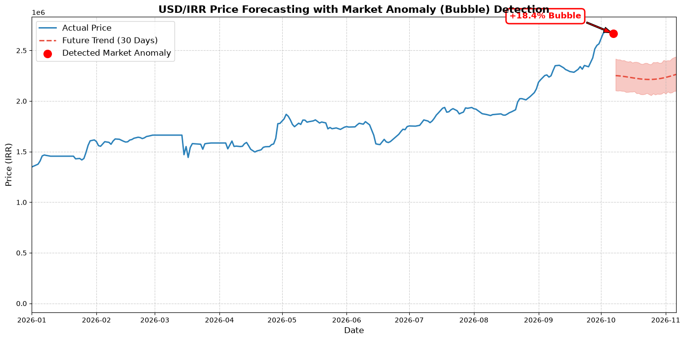

# USD/IRR Price Forecasting & Market Anomaly Detection 📈

A machine learning project focused on forecasting the USD to IRR (Iranian Rial) exchange rate and detecting market anomalies (bubbles) using time-series analysis.

## 🎯 Project Overview
The Iranian economy has experienced exponential currency growth over the past few decades. Traditional tree-based machine learning models (like XGBoost) struggle with extrapolating exponential trends. This project solves that problem by utilizing the **Prophet** model combined with **Log Transformation** to accurately forecast future prices and identify temporary market bubbles.

## ✨ Key Features
- **Time-Series Forecasting:** Predicts the next 30 days of the USD/IRR exchange rate.
- **Market Anomaly (Bubble) Detection:** Compares the actual market price with the model's calculated intrinsic trend to detect overvalued (bubble) states.
- **Regime Shift Handling:** Filters out outdated historical data to focus on the modern economic structure (2018-present).
- **Logarithmic Transformation:** Successfully normalizes exponential growth curves for better model fitting.

## 📊 Results
The model successfully identifies the underlying trend and calculates the deviation of the current market price from its intrinsic value. 



## 🛠️ Tech Stack
- Python
- Pandas & NumPy (Data Manipulation)
- Prophet (Time-Series Forecasting)
- Matplotlib (Data Visualization)

## 🚀 How to Run
1. Clone this repository.
2. Install the required packages:
   ```bash
   pip install -r requirements.txt
